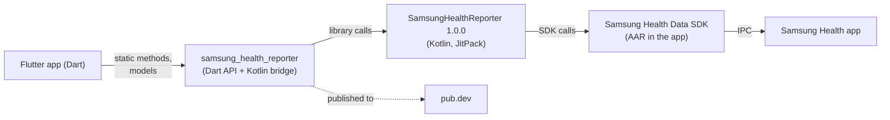
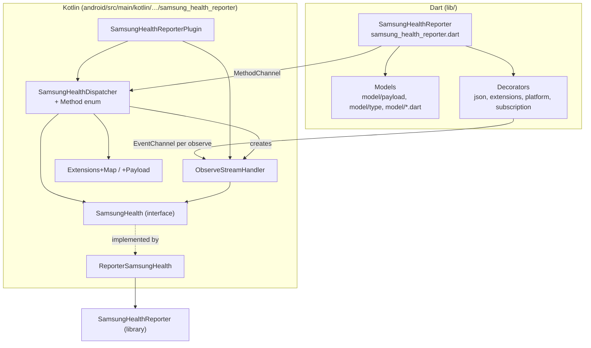
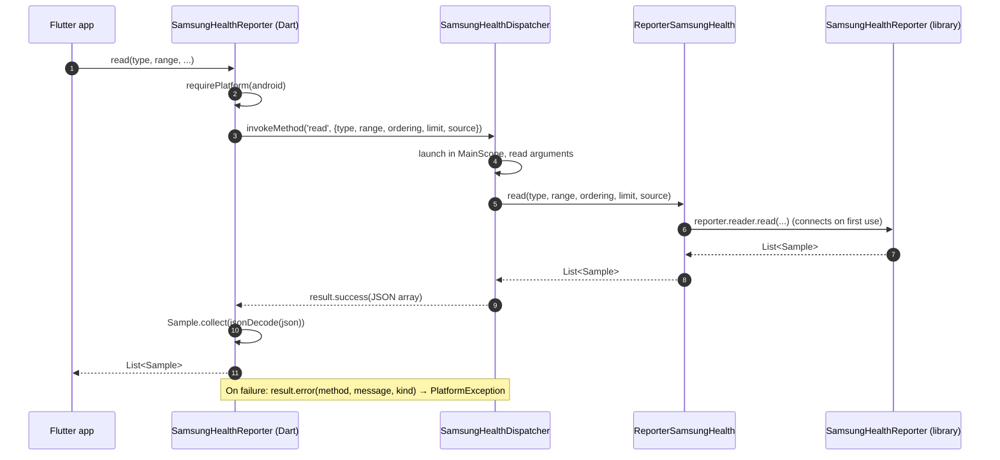
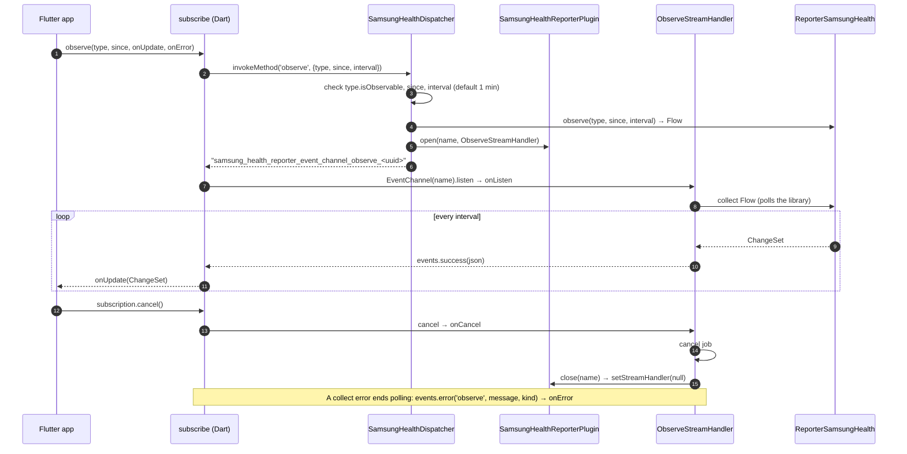
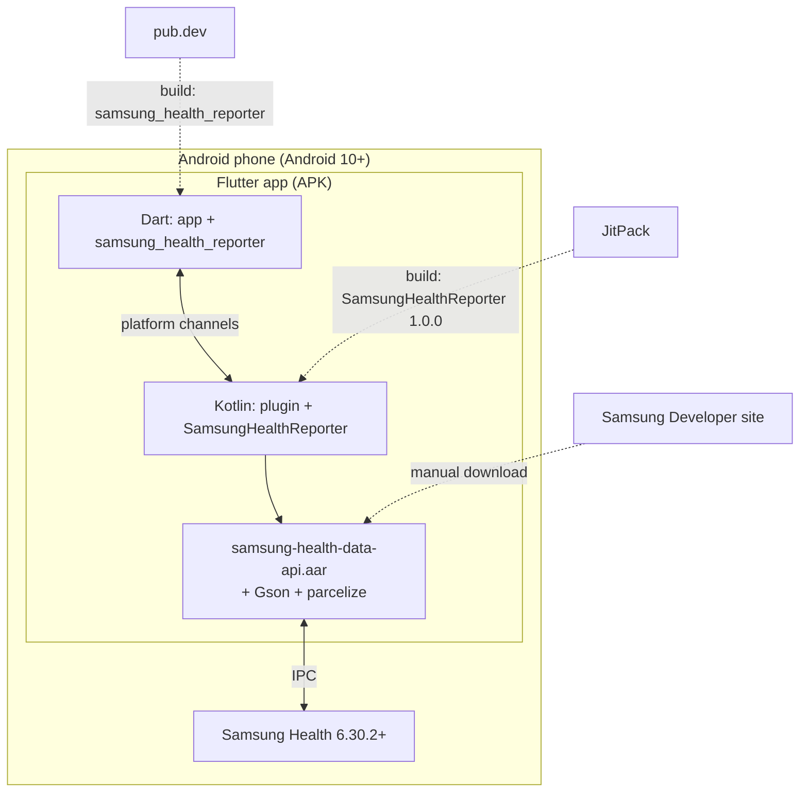
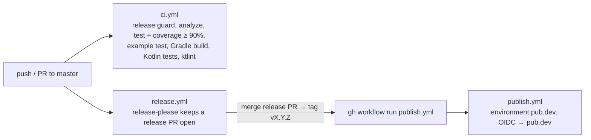

# samsung_health_reporter — Architecture (arc42)

The architecture of the Flutter plugin `samsung_health_reporter`, following the [arc42](https://arc42.org) template. Conventions and rules live in [AGENTS.md](../../AGENTS.md); decisions in [doc/adr/](../adr/).

## 1. Introduction and Goals

`samsung_health_reporter` gives Flutter apps on Android access to Samsung Health. It exposes the Kotlin library [SamsungHealthReporter](https://github.com/kvs-coder/SamsungHealthReporter) 1.0.0, which wraps the Samsung Health Data SDK, to Dart as the static API `SamsungHealthReporter`.

**Requirements**

| Area | Dart methods |
| :--- | :--- |
| Manager | `isAvailable`, `requestPermissions`, `grantedPermissions`, `isAuthorized`, `resolve`, `localDevice`, `devices`, `device` |
| Reader | `read`, `readPage`, `userProfile`, `aggregate` |
| Writer | `insert`, `update`, `delete`, `deleteByUids`, `deleteByClientDataIds` |
| Observer | `changes`, `observe` (live subscription) |

**Quality goals**

1. **Fidelity**: the plugin mirrors the library 1:1 — methods, types, JSON and errors.
2. **Testability**: every method is tested without Samsung Health, on both sides of the channel.
3. **Isolation**: observe subscriptions run and stop independently.

**Stakeholders**

| Role | Expectation |
| :--- | :--- |
| Flutter app developers | A typed Dart API whose behaviour matches SamsungHealthReporter's documentation |
| Maintainer | One source of truth (the library's JSON), automated releases |

## 2. Architecture Constraints

| Constraint | Consequence |
| :--- | :--- |
| Samsung Health Data SDK is Android only | The plugin is Android only; elsewhere `isAvailable` is false and every other method throws `UnsupportedError` |
| SDK license forbids redistribution | The app adds `samsung-health-data-api*.aar` (plus Gson and parcelize); the plugin never ships it |
| SDK needs Android 10 and Samsung Health 6.30.2+ | `minSdk = 29` |
| SamsungHealthReporter 1.0.0 from JitPack | The app adds `maven("https://jitpack.io")`; Java/JVM 17 |
| Flutter 3.44+ / Dart 3.5+ | SDK constraints in `pubspec.yaml` |
| Writes need Samsung partner approval | Without an access code every write fails with `NotAuthorized`; reading works in Samsung Health's developer mode |

## 3. System Scope and Context

| Neighbour | Interface |
| :--- | :--- |
| Flutter app | `SamsungHealthReporter` static methods, models in `lib/model/`, `PlatformException` errors |
| SamsungHealthReporter | Kotlin API (`manager`, `reader`, `writer`, `observer`), payloads with `json` and `make(from:)` |
| Samsung Health Data SDK / app | Owned by the library; plugin Kotlin never imports `com.samsung.android.sdk` |

## 4. Solution Strategy

- **Thin bridge over one library**: mapping SDK data points to payloads happens in SamsungHealthReporter; the plugin only moves arguments and replies across the channel.
- **JSON as contract**: payloads cross as the library's `json`; Dart parses them into immutable models and sends their `map`s back, which the library reads with `make(from:)`.
- **One method channel, one event channel per subscription**: one-shot calls share `samsung_health_reporter_method_channel`; each `observe` gets its own channel, so subscriptions never share polling.
- **Testing seam**: the dispatcher talks to the `SamsungHealth` interface, which unit tests mock, since the library's services need the SDK on the classpath.

## 5. Building Block View

### Level 1

| Block | Responsibility |
| :--- | :--- |
| `SamsungHealthReporter` (Dart) | Static methods; checks the platform, sends arguments as maps, parses JSON replies into models |
| Models | `final` fields, `fromJson` / `map` with the library's keys, value equality through the `Payload` mixin; `Sample.factory` picks the payload class by `type` and throws `InvalidValueException` for an unknown one |
| Types | Enhanced enums (`HealthType`, `Aggregation`, value enums) carrying the Kotlin name; `HealthType` adds `identifier`, `isReadable`, `isWritable`, `isObservable` |
| Decorators | Number and list parsing (`json.dart`, `extensions.dart`), platform guard (`platform.dart`), observe subscriptions (`subscription.dart`) |
| `SamsungHealthReporterPlugin` | Registers the method channel, owns the `MainScope` and the open event channels; cancels both when the engine detaches; tracks the current `Activity` |
| `SamsungHealthDispatcher` | One `Method` case per Dart method: reads arguments, calls `SamsungHealth`, replies JSON or a bool, or an error |
| `ObserveStreamHandler` | Collects one subscription's change sets while Dart listens; cancelling stops it and closes its channel |
| `SamsungHealth` / `ReporterSamsungHealth` | The library calls the dispatcher makes; the implementation forwards to one lazily connected `SamsungHealthReporter` and keeps the last `Resolvable` error for `resolve` |
| `Extensions+Map` / `Extensions+Payload` | Typed argument readers (missing keys → `InvalidValue`); JSON replies and the error kind for `details` |

### Example app (`example/`)

`Catalog` builds `DemoSection`s (Manager, Reader, Aggregates, Writer, Observer) of `DemoRow`s. `CatalogBloc` and `SetupBloc` (on a plain-stream `Bloc` base) call the plugin; `DemoPage` and `demo_widgets.dart` only render states. `integration_test/catalog_test.dart` runs every row on a phone.

## 6. Runtime View

### One-shot call: `read`

### Live subscription: `observe` and cancel

## 7. Deployment View

**Delivery pipeline** (`.github/workflows/`):

## 8. Crosscutting Concepts

- **JSON contract**: keys and value shapes follow the library exactly — timestamps epoch milliseconds, enums by Kotlin name, a sample's `type` = `HealthType.identifier`. Lists reply as JSON arrays; `readPage` replies `{"items":[...],"nextPageToken":"..."}`.
- **Identity**: `uid` names the stored data point, `clientDataId` the app's own id; update and delete send the sample's `map` with both.
- **Errors**: every failure is a `PlatformException` — `code` the method name, `message` the library's message, `details` the kind as a `String`: `NotAuthorized`, `InvalidType`, `InvalidValue`, `Resolvable` or `Platform(<code>)`. Observe errors arrive on `onError` with code `observe`. `resolve` starts the fix for the last `Resolvable` error.
- **Threads**: calls run in the plugin's `MainScope`; results and events are delivered on the platform thread.
- **Connection**: `ReporterSamsungHealth` creates the `SamsungHealthReporter` on the first call that needs it; calls needing UI (`requestPermissions`, `resolve`) need a foreground `Activity`.
- **Platform guard**: `isAvailable` is false outside Android; every other method throws `UnsupportedError` before any channel call.
- **Parsing**: numbers through `parseInt` / `parseDouble` / `parseNum`; optional and later-added fields are nullable.
- **Testing**: Dart API tests against mocked `MethodChannel` / `EventChannel`; model tests against fixtures shaped like the library's JSON (`test/fixtures.dart`); Kotlin dispatcher and stream handler tests against a mocked `SamsungHealth` (JUnit 5, MockK).

## 9. Architecture Decisions

| ADR | Decision |
| :--- | :--- |
| [0001](../adr/0001-samsung-health-reporter-for-flutter.md) | A Flutter plugin of its own for Samsung Health, Android only, mirroring SamsungHealthReporter 1:1 |

## 10. Quality Requirements

| Quality | Scenario | Measure |
| :--- | :--- | :--- |
| Fidelity | A library payload is read, sent back for update and deleted | `map` → `fromJson` round trips; keys checked against fixtures |
| Correctness | Every Dart method sends its arguments and parses its reply or error | API tests per method; Kotlin dispatcher tests per `Method` |
| Coverage | A change lowers test coverage of `lib/` | CI fails below 90 % line coverage |
| Isolation | Two subscriptions on the same type; one is cancelled | Separate event channels and coroutine jobs; the other keeps polling |
| Robustness | Samsung Health is missing or not set up | `isAvailable` false or a `Resolvable` error; no crash |
| Style | Kotlin or Dart change | ktlint 1.8.0 and `flutter analyze` clean in CI |

## 11. Risks and Technical Debt

| Risk / debt | Impact | Mitigation |
| :--- | :--- | :--- |
| `BloodGlucose.endTimestamp` is optional in SamsungHealthReporter, but Samsung Health rejects inserts without it ("End time must be set") | Inserting blood glucose without an end time fails at runtime | Set `endTimestamp`; fix in the library |
| Writes need a Samsung partner access code | Every write fails with `NotAuthorized` until approval; writes are untested on a device | Request read and write permissions separately; read-only use in developer mode |
| The SDK AAR can't be redistributed | Every app (and the example) must download it manually; CI builds without it | Setup in README; AAR git-ignored in `example/android/app/libs/` |
| Integration tests need a phone with Samsung Health | `integration_test/catalog_test.dart` runs manually, not in CI | Run it before dispatcher changes (AGENTS.md §6D) |
| Dependency on a single library version from JitPack | JitPack outage or library changes break builds and the JSON contract | Pinned to 1.0.0; library changes are mirrored deliberately |

## 12. Glossary

| Term | Meaning |
| :--- | :--- |
| Samsung Health Data SDK | Samsung's Android SDK to read and write Samsung Health data, shipped as an AAR |
| SamsungHealthReporter | The Kotlin library wrapping the SDK; the plugin's only native dependency |
| `HealthType` | A kind of Samsung Health data, e.g. `HEART_RATE`; carries its `identifier` and capabilities |
| Sample / `WritableSample` | A stored data point; writable ones can be inserted, updated and deleted |
| `uid` / `clientDataId` | Samsung Health's id of a data point / the app's own id for it |
| Aggregation | A server-side summary, e.g. `STEPS_TOTAL`, optionally grouped by `TimeGroup` |
| `ChangeSet` | Upserted samples and deleted `uid`s of a type between `since` and `until` |
| Observe subscription | A polled stream of `ChangeSet`s on its own event channel |
| `Resolvable` | An error Samsung Health can fix itself, e.g. by installing or updating the app |
| Partner access code | Samsung's approval needed for writes and for distributing the app |
| Epoch milliseconds | The timestamp format of every time field |
